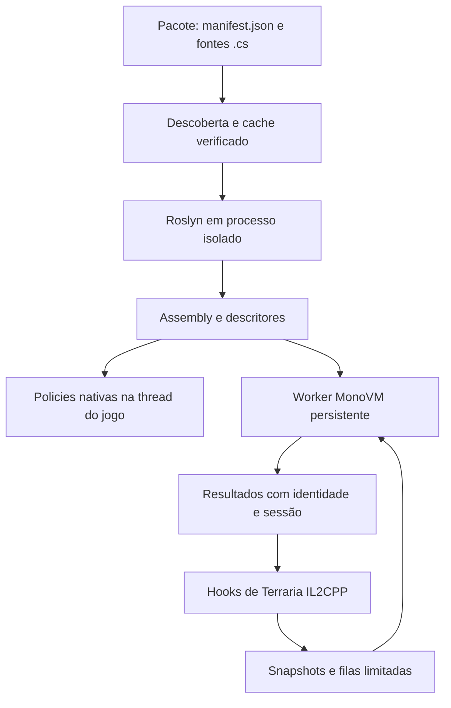

# Arquitetura C#

O loader, Roslyn, MonoVM e Terraria IL2CPP têm responsabilidades separadas.
O C# implementado não depende do motor JS para carregar ou executar policies.

## Módulos

| Responsável | Fontes canônicos |
| --- | --- |
| Descoberta, cache e preparo antes do mundo | [AutoSourceRuntime.cpp](../Split/Bunny-Loader/app/src/main/cpp/experiments/csharp/AutoSourceRuntime.cpp) |
| SDK fonte | [BunnySourceSdk.csproj](../Split/Bunny-Loader/experiments/csharp/BunnySourceSdk/BunnySourceSdk.csproj) e [classes públicas](../Split/Bunny-Loader/experiments/csharp/BunnyCsSdk/) |
| Compilador/descritores | [BunnySourceCompiler](../Split/Bunny-Loader/experiments/csharp/BunnySourceCompiler/) |
| Worker, GC, filas e Mono | [ManagedRuntime.cpp](../Split/Bunny-Loader/app/src/main/cpp/experiments/csharp/ManagedRuntime.cpp) |
| Instâncias C# de entidades | [BunnyEntitySourceDispatcher.cs](../Split/Bunny-Loader/experiments/csharp/BunnyCsSdk/BunnyEntitySourceDispatcher.cs) |
| Hooks de entidades | [ManagedProjectileHook.cpp](../Split/Bunny-Loader/app/src/main/cpp/experiments/csharp/ManagedProjectileHook.cpp), [NpcAiHost.cpp](../Split/Bunny-Loader/app/src/main/cpp/experiments/csharp/NpcAiHost.cpp) |
| Equipamento e armaduras | [NativeItemPolicies.cpp](../Split/Bunny-Loader/app/src/main/cpp/experiments/csharp/NativeItemPolicies.cpp), [NativeArmorPolicies.cpp](../Split/Bunny-Loader/app/src/main/cpp/experiments/csharp/NativeArmorPolicies.cpp) |
| Receitas/registros compartilhados | [content/recipes](../Split/Bunny-Loader/app/src/main/cpp/content/recipes/) e [content/common](../Split/Bunny-Loader/app/src/main/cpp/content/common/) |
| Relatório Android | [BootLog.kt](../Split/Bunny-Loader/app/src/main/kotlin/dev/bunnyloader/game/BootLog.kt) |

## Execução

Defaults e receitas produzem descritores. Equipamento, armaduras, animação,
luz e curvas amostradas têm execução nativa. Callbacks de entidades recebem
snapshots no worker; não recebem ponteiros livres para objetos do Terraria.

A IA é amostrada a cada seis ticks; a `.62` antecipa o primeiro tick de
projéteis recém-observados. Velocidade só é aplicada quando identidade,
geração, owner e sessão ainda correspondem. Curva nativa, SourceBolt e
SourceSpark mantêm prioridade de movimento; o ciclo C# de eventos continua.

Eventos assíncronos usam filas limitadas e entrada não bloqueante. Falhas podem
isolar o tipo/mod; contexto ausente, estado antigo e saturação podem recusar
eventos. Dano do jogador tem outro contrato: decisão síncrona com prazo de até
5 ms e descarte de retornos atrasados. [Contratos completos](SDK-CSharp.md).

O host confere métodos, assinaturas, tipos/larguras/offsets e layouts antes de
instalar o caminho nativo. `WorldItem.active` usa getter; Color pode ter layout
ABGR em outro namespace. [Correção de ABI](csharp-pr28-native-contract-fixes.md).

Não há promessa de todos os hooks do tModLoader, C# geral por frame,
multiplayer universal ou hot-unload. [Host](../tests/README.md) verifica
contratos; [Android](SDK-VALIDACAO.md) comprova comportamento e custo observado.
