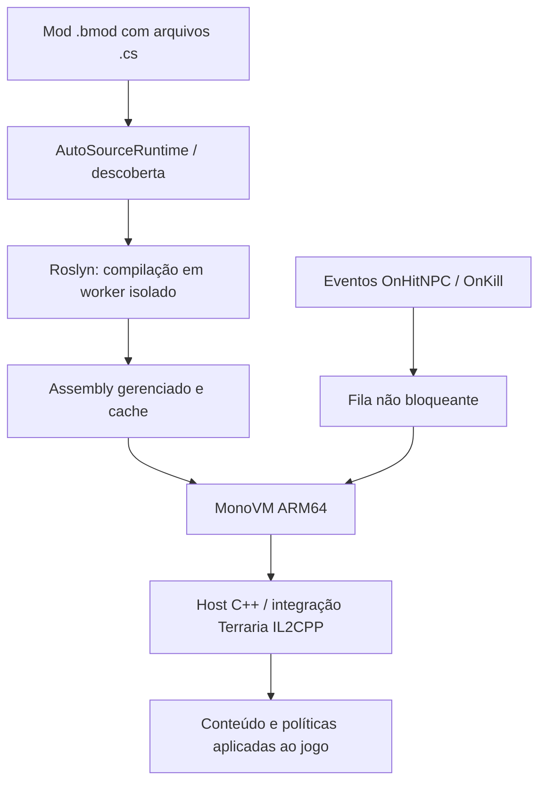

# Arquitetura da integração C#

O objetivo é **estender o Bunny Loader de Jonata**, não recriar o tModLoader nem substituir o suporte JavaScript/QuickJS do projeto original. Os fontes do loader e o código específico da extensão seguem no mesmo projeto Android.

## Fontes canônicos

- **Base Android do Bunny:** [`Split/Bunny-Loader/app/`](../../Split/Bunny-Loader/app)
- **Host C++ do C#:** [`experiments/csharp/`](../../Split/Bunny-Loader/app/src/main/cpp/experiments/csharp); principalmente `ManagedRuntime.cpp`, `AutoSourceRuntime.cpp`, `SourceLoader.cpp`, `ManagedHitHook.cpp` e `ManagedKillHook.cpp`.
- **Ponte para APIs expostas ao editor:** [`CSharpPrototypeApi.cpp`](../../Split/Bunny-Loader/app/src/main/cpp/script/api/CSharpPrototypeApi.cpp).
- **Compilador Roslyn:** [`BunnySourceCompiler/`](../../Split/Bunny-Loader/experiments/csharp/BunnySourceCompiler).
- **Mod de exemplo e testes:** [`ExampleModCSharp/`](../../Split/Bunny-Loader/samples/ExampleModCSharp).
- **Testes nativos:** [`Split/Bunny-Loader/tests/`](../../Split/Bunny-Loader/tests).

O diretório [`src/`](../../src/README.md) apenas cria atalhos para esses locais. **Não existem duas cópias editáveis do mesmo código.**

## Modelo de execução e desempenho

1. O arquivo `.cs` é compilado pelo fluxo experimental Roslyn e a identidade do mod é verificada.
2. O runtime do MonoVM mantém uma thread proprietária; a correção .58 protege transições de espera nativa/GC.
3. Nas rotas atuais de projétil, parte da lógica gerenciada produz parâmetros e **políticas pré-calculadas** que são aplicados nativamente, evitando executar C# a cada frame.
4. A .59 demonstra um callback C# gerenciado real para `OnHitNPC`; a .60 tenta vincular automaticamente `OnHitNPC` e `OnKill` do ExampleModCSharp.
5. Os hooks só depositam inteiros numa fila curta: o frame do Terraria **não aguarda** a chamada ao MonoVM. Isso protege o frame, mas eventos podem ser descartados quando a fila está ocupada — verificar `dropped`.

## O que a arquitetura ainda não garante

Não há suporte universal a todos os hooks/classes do tModLoader, AI C# gerenciada por frame, multiplayer com essa ponte nem múltiplos mod/projéteis arbitrários no vínculo automático. O CI mede compilação e contratos simulados, **não** mede jogabilidade real, latência ou FPS no Android. Não incorporar APIs do tModLoader sem adaptar e comprovar contra o ExampleModBunny e o Bunny Loader real.
